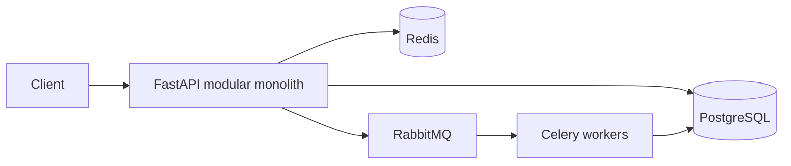
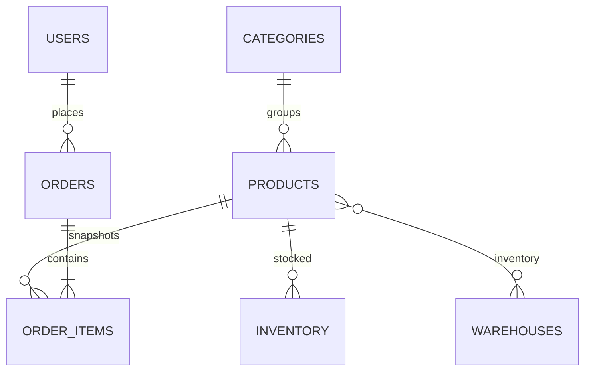

# Distributed E-Commerce Order & Inventory Management

A Python 3.12, FastAPI modular-monolith starter with PostgreSQL transactional inventory reservations, JWT authentication, Redis/RabbitMQ infrastructure, and Docker Compose.

## Run
Copy `backend/.env.example` to `backend/.env`, set a private JWT secret, then run `docker compose up --build` from `backend`. Open `/docs`.

## Implemented API
- `POST /api/v1/auth/register`, `POST /api/v1/auth/login`
- `GET /api/v1/products`, `GET /api/v1/products/{id}`, admin `POST /api/v1/products`
- `GET /api/v1/inventory/{product_id}`, authenticated `POST /api/v1/inventory/reserve`
- `GET /health`

Inventory uses a single conditional SQL update (`on_hand - reserved >= quantity`) so concurrent reservations cannot oversell; callers receive 409 on contention/out-of-stock. This provides database atomicity without a read-then-write race. Passwords use Argon2 and JWT is signed with HS256.

## Architecture

## Data model

## Engineering decisions
- Conditional inventory updates avoid overselling and do not depend on application-level locks.
- Outbox events are persisted alongside business state as the foundation for reliable at-least-once publication; consumers must deduplicate by event ID.
- PostgreSQL is authoritative; cache entries are disposable. Never cache inventory availability for checkout decisions.
- Payment provider boundary should be implemented with a gateway adapter; no card data is stored.

## Scope and validation
The included implementation focuses on a runnable core (auth, product reads/admin creation, and atomic inventory reserve). Order lifecycle, refunds, outbox dispatcher, Celery task definitions, carts, OAuth2 refresh, and complete migration/test suite remain extension work. No benchmark numbers are claimed.
